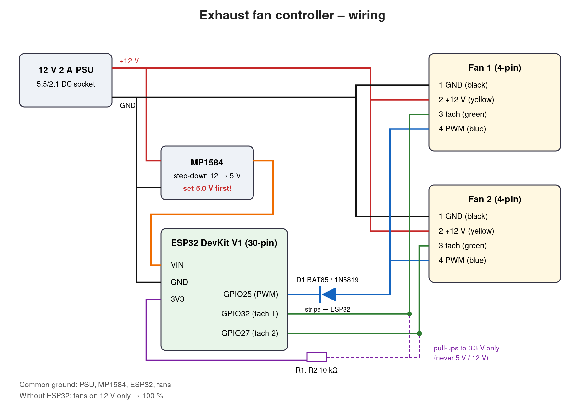

# exhaust-fan-esphome

ESP32 + ESPHome controller for a push-pull pair of 4-pin PWM fans in a 100 mm exhaust duct,
with Home Assistant blueprints that follow a Bambu Lab printer (laser jobs, ASA/ABS prints,
run-on after the job).

Built for the 3D-printed inline fan module on MakerWorld: **https://makerworld.com/en/models/3672876**.
Works with any 12 V 4-pin PWM fans (Intel 4-wire spec, 25 kHz, open-collector tach).

- one PWM signal drives both fans (push-pull fans should always run at the same speed),
- two tach inputs → RPM of each fan + a **fault** sensor (stall or > 25 % mismatch),
- slider 1–100 % is linear: the fans' dead zone below ~9 % duty is skipped, 0 % = stop.

You don't need the ESP32 at all: on plain 12 V with the PWM wire unconnected, 4-pin fans run at 100 %.

## What you need

Printed parts and print profiles: MakerWorld – https://makerworld.com/en/models/3672876

**Filament** (H2C, 0.4 nozzle): ASA ~344 g (covers, bayonet ends) · PETG ~261 g (wall rail, electronics box, 2 duct holders) · TPU 90A ~26 g (gaskets, sleeves, fit test).

**Fan module**
- 2× Noctua NF-F12 industrialPPC-3000 PWM (12 V, ~0.3 A each, tach 2 pulses / rev) – other 120 × 25 mm 4-pin PWM fans fit too
- 4× M4 × 70 socket head screw + nut + washer
- 2× hose clamp 90–110 mm, 100 mm duct (aluminium or the Bambu exhaust hose)
- 6× 6 mm wall plug + 4–4.5 mm countersunk wood screw (rail 3, electronics box 1, duct holders 2)

**Power**
- 12 V 2 A plug-in power supply, 5.5/2.1 mm (2 × 0.3 A fans + ESP32 ≈ 0.8 A; the rest is margin for start-up)
- panel-mount DC socket 5.5/2.1 (Ø 10.5 mm hole in the printed box)

**Electronics (optional)**
- ESP32 DevKit V1, 30-pin (ESP32-WROOM-32, `board: esp32dev`)
- MP1584 step-down 12 → 5 V – **set it to 5.0 V with a multimeter before connecting the ESP32**
- perfboard 70 × 50 mm, 2× female header 1 × 15, 2× male header 1 × 4 (2.54 mm) – the ESP32 stays removable
- Schottky diode BAT85 / BAT43 / 1N5819 (PWM level shifting), 2× 10 kΩ resistor (tach pull-ups to 3.3 V)
- thin wire (UTP strands are enough), heat-shrink
- box lid: 4× M3 heat-set insert (Ø 4.2, 6 mm long) + 4× M3 × 10 countersunk screw (DIN 7991)
- nice to have, not required: 2× 4-pin PWM fan extension cable 30 cm (the fans plug straight onto the male headers)

Tools: soldering iron (+ insert tip), multimeter, screwdriver, 6 mm drill.

**Without the ESP32** the fans just need 12 V: build the perfboard without the ESP32 (leave its sockets empty – the PWM line
floats high and the fans run at 100 %), or use any 12 V → 4-pin fan power cable. Loud, but it works.

## Wiring



Fan connector (4-pin): 1 = GND (black), 2 = +12 V (yellow), 3 = tach (green), 4 = PWM (blue).

| Net | Connects |
|---|---|
| +12 V | DC + → MP1584 IN+ → pin 2 of both fans |
| GND | DC − → MP1584 IN− → pin 1 of both fans → ESP32 GND (**common ground is required**) |
| +5 V | MP1584 OUT+ (5.0 V!) → ESP32 **VIN** |
| PWM | ESP32 **GPIO25** → **diode cathode (stripe)** → anode → pin 4 of **both** fans |
| Tach 1 | fan 1 pin 3 → ESP32 **GPIO32** + 10 kΩ to **3.3 V** |
| Tach 2 | fan 2 pin 3 → ESP32 **GPIO27** + 10 kΩ to **3.3 V** |

Why the diode: the fan pulls its PWM input up to ~5 V (measured 4.92 V on the NF-F12 iPPC),
too much for an ESP32 pin. With the cathode towards the ESP32, a low GPIO pulls the line
down to ~0.3 V through the diode, a high GPIO lets it float to ~3.6 V – still "high" for the
fan, and no current is pushed into the ESP32. No change in the config.
Alternative: NPN (BC547 / 2N2222; GPIO → 1 kΩ → base, emitter → GND, collector → PWM) or
N-MOSFET (2N7000; GPIO → 100 Ω → gate, 10 kΩ gate–GND) – then add `inverted: true` to the output.

**Measure your fan first**: with the fan on 12 V and nothing on pin 4, measure pin 4 → GND.
≤ 3.3 V – the diode is optional; ~5 V (NF-F12 iPPC) – use the diode; clearly more than 5 V – use the NPN / MOSFET.
The tach (pin 3) → GND should read ~0 V (open collector). Never pull the tach up to 5 V or 12 V.

Pins avoid the ESP32 boot strapping pins (0, 2, 5, 12, 15) and the input-only pins without
pull-ups (34–39); there is always one unused pin between GPIO32 · 25 · 27 on the header,
so a solder bridge is less likely.

### Perfboard layout (70 × 50 mm, columns A–X, rows 1–18, component side, ESP32 USB to the right)

```
       A  B  C  D  E  F  G  H  I  J  K  L  M  N  O  P  Q  R  S  T  U  V  W  X
 r1    ·  ·  ·  ·  ·  ·  ·  ·  ·  ·  ·  ·  ·  ·  ·  ·  ·  ·  ·  ·  ·  ·  ·  ·
 r2    ·  ·  ·  ·  ·  ·  ·  ·  o  o  o  o  o  o  o  o  o  o  o  o  o  o  3  ·   ← top header (3V3 = W2)
 r3    ·  ·  ·  ·  ·  ·  ·  ·  ·  ·  ·  ·  ·  ·  ·  ·  ·  ·  ·  ·  ·  ·  3  ·
 r4    ·  ·  ·  ·  ·  ·  ·  ·  ·  ·  ·  ·  ·  ·  ·  ·  ·  ·  ·  ·  ·  ·  3  ·
 r5    ·  ·  ·  ·  ·  ·  ·  ·  ·  ·  ·  ·  ·  ·  ·  ·  ·  ·  ·  ·  ·  ·  3  ·
 r6    ·  ·  ·  ·  ·  ·  ·  ·  ·  ·  ·  ·  ·  3  3  3  3  3  3  3  3  3  3  ·   ← 3V3 rail
 r7    ·  ·  ·  ·  ·  ·  ·  ·  ·  ·  ·  ·  ·  |  ·  ·  ·  |  ·  ·  ·  ·  ·  ·
 r8    ·  ·  ·  ·  ·  ·  ·  ·  ·  ·  ·  ·  · R1  ·  ·  · R2  ·  ·  ·  ·  ·  ·
 r9    ·  ·  ·  ·  ·  ·  ·  ·  ·  ·  ·  ·  ·  |  ·  ·  ·  |  ·  ·  ·  ·  ·  ·
 r10   ·  ·  ·  ·  ·  ·  ·  ·  ·  ·  ·  ·  ·  T  ·  ·  ·  t  ·  ·  ·  ·  ·  ·
 r11   ·  ·  ·  ·  ·  ·  ·  ·  ·  ·  ·  ·  ·  T  ·  ·  ·  t  ·  ·  ·  ·  ·  ·
 r12   ·  ·  ·  ·  ·  ·  ·  ·  o  o  o  o  o  T  o  P  o  t  o  o  o  G  V  ·   ← bottom header
 r13   ·  M  M  M  M  M  M  M  M  ·  ·  ·  ·  T  ·  P  ·  t  ·  ·  ·  G  V  ·
 r14   ·  M  M  M  M  M  M  M  M  ·  ·  ·  ·  ·  ·  |  ·  ·  ·  ·  ·  ·  ·  ·
 r15   ·  M  M  M  M  M  M  M  M  -  -  -  ·  ·  · D1  ·  ·  ·  ·  4  ·  ·  4   ← fan pin 4 PWM
 r16   ·  M  M  M  M  M  M  M  M  ·  ·  ·  ·  ·  ·  |  ·  ·  ·  ·  3  ·  ·  3   ← pin 3 tach
 r17   ·  M  M  M  M  M  M  M  M  ·  ·  ·  ·  ·  ·  K  ·  ·  ·  ·  2  ·  ·  2   ← pin 2 +12 V
 r18   ·  M  M  M  M  M  M  M  M  +  +  +  ·  ·  ·  ·  ·  ·  ·  ·  1  ·  ·  1   ← pin 1 GND (black, board edge)
                                                                     F1       F2
```

`o` unused header pin · `3` 3.3 V · `V` +5 V (VIN) · `G` GND · `T` tach 1 (GPIO32) · `t` tach 2 (GPIO27) ·
`P` PWM from ESP32 (GPIO25 → diode cathode) · `K` fan PWM line (diode anode) · `-` GND pad · `+` 12 V pad ·
`M` MP1584 (double-sided foam tape) · `1–4` fan headers (F1 column U, F2 column X).
DevKit pins in the headers (I → W): bottom row r12 = EN, VP, VN, D34, D35, **D32**, D33, **D25**, D26, **D27**, D14, D12, D13, **GND**, **VIN**;
top row r2 = D23, D22, TX0, RX0, D21, D19, D18, D5, TX2, RX2, D4, D2, D15, GND, **3V3**. Check against the labels printed on your board – clones differ.
Same symbol in neighbouring holes = bridged on the back. 12 V stays in the bottom rows, ≥ 4 rows from the ESP32 pins.

Wires on the back: N13 → U16, R13 → X16, P17 → U15 → X15, L15 → U18 → X18, L18 → U17 → X17;
MP1584 IN+ → J18, IN− → J15, OUT+ → W13, OUT− → V13; DC socket + → K18, − → K15.
Keep V13 and W13 apart (5 V vs GND). Mark "▼ BLACK" next to row 18 – the male headers have no key.

### Checks before inserting the ESP32

1. **No power, fans unplugged:** 12 V pad ↔ every ESP32 socket = open; VIN ↔ GND and 3V3 ↔ GND not shorted;
   GPIO32/27 ↔ 3V3 ≈ 10 kΩ; GPIO12 ↔ 3V3 open; diode test U15 (red) → GPIO25 (black) 0.15–0.4 V.
2. **12 V on, fans unplugged:** U17/X17 = 12 V; VIN socket = **4.9–5.1 V** (12 V here = MP1584 in/out swapped – stop).
3. **12 V on, fans plugged:** both spin at full speed; PWM line ≈ 4.9 V; GPIO32, GPIO27, 3V3 sockets < 1 V.
4. Flash the ESP32 on your desk over USB, **power off 12 V**, insert it, power on. Later updates via OTA.
   Never power the ESP32 from USB and the MP1584 at the same time.

## ESPHome

Copy [`example.yaml`](example.yaml) into ESPHome Device Builder (or the `esphome` CLI), create `secrets.yaml`
from [`secrets.yaml.example`](secrets.yaml.example). First install over USB ("Plug into this computer"), later wirelessly (OTA);
then add the device in Home Assistant (Settings → Devices & services, it is discovered automatically).
The fan logic comes in as a remote package:

```yaml
packages:
  exhaust_fan: github://FilipWyka/exhaust-fan-esphome/exhaust-fan.yaml@v1.0.0
```

Override pins or tuning in your own `substitutions:` (`pwm_pin`, `tach1_pin`, `tach2_pin`,
`min_power`, `fault_rpm`, `fault_mismatch`, `fault_delay`). `min_power: 0.09` is measured for the
NF-F12 iPPC-3000 – for other fans set the slider to 1 %, 5 %, 10 % and raise `min_power` until 1 % is
the lowest stable speed.

Entities: `fan.<name>_fans` (on/off + 0–100 %), `sensor.<name>_fan_1_speed`, `sensor.<name>_fan_2_speed` (RPM),
`binary_sensor.<name>_fan_fault`, `sensor.<name>_wifi_signal`.

Measured (2× NF-F12 iPPC-3000, `min_power: 0.09`):

| Slider % | 0 | 1 | 10 | 20 | 30 | 40 | 50 | 60 | 70 | 80 | 90 | 100 |
|---|---|---|---|---|---|---|---|---|---|---|---|---|
| Fan 1 RPM | 0 | 264 | 564 | 870 | 1170 | 1458 | 1740 | 2004 | 2256 | 2502 | 2748 | 3012 |
| Fan 2 RPM | 0 | 288 | 564 | 858 | 1134 | 1404 | 1662 | 1908 | 2148 | 2382 | 2610 | 2844 |

## Home Assistant blueprints

Requires [ha-bambulab](https://github.com/greghesp/ha-bambulab) (HACS) for the printer entities.

- **[Follow Bambu Lab printer](blueprints/exhaust_fan_bambu_lab.yaml)** – laser job → 100 %, heating-mode print
  (ASA/ABS/PC/PA) → low speed (default 40 %, set it so your chamber stays warm), cooling-mode print (PLA/PETG/TPU) → off,
  15 min run-on after heating prints and laser jobs. Driven by `airduct_mode` (cooling / heating / laser), not by the active filament: while the H2
  printers detect the hotend or change filament, the active AMS tray flickers through every slot.
  [](https://my.home-assistant.io/redirect/blueprint_import/?blueprint_url=https%3A%2F%2Fgithub.com%2FFilipWyka%2Fexhaust-fan-esphome%2Fblob%2Fmain%2Fblueprints%2Fexhaust_fan_bambu_lab.yaml)
- **[Fault alert](blueprints/exhaust_fan_fault_alert.yaml)** – your actions (e.g. phone notification) when the
  fault sensor stays on.
  [](https://my.home-assistant.io/redirect/blueprint_import/?blueprint_url=https%3A%2F%2Fgithub.com%2FFilipWyka%2Fexhaust-fan-esphome%2Fblob%2Fmain%2Fblueprints%2Fexhaust_fan_fault_alert.yaml)

Optional for H2C users: [gradual chamber purge after ASA](docs/h2c-end-gcode-purge.md) – a custom end G-code
block that opens the rear vent and ramps the printer's exhaust 20 → 100 % over ~20 min; the blueprint follows it.

How the H2C handles its own air (Bambu wiki, "H2 cooling fan system"): in heating mode the rear vent is closed and
the chamber is heated, so the duct fan should only run low (slight negative pressure without cooling the chamber);
at the end of the print the printer vents the chamber – that's when most fumes come out, hence the run-on.
Tested on an H2C. Other Bambu printers that report `airduct_mode` in ha-bambulab may work the same way (untested).

## Safety

- This moves air, it does not filter it. The duct must end outside.
- Laser fumes: keep the run-on, and don't rely on the alert alone – check the fan before a laser job.
- Never connect 12 V or 5 V to an ESP32 GPIO; tach pull-ups go to 3.3 V only.

## License

MIT – see [LICENSE](LICENSE). The 3D-printed parts are published on MakerWorld under their own license.
